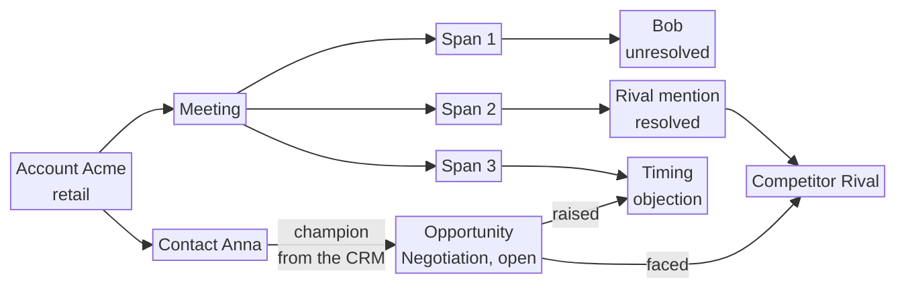

  
Use case and system design

  <h1 class="text-5xl !mb-4">Account intelligence for sellers</h1>
  
A knowledge graph for one selling company

  
Acme · Anna · Bob · Rival

---
layout: center
class: text-center
---

# Use case

---

# The use case

  

    
Problem

    
The deal went quiet

    
Late stage, one known contact, no recent activity.

  

  

    
What we connect

    
CRM and calls

    
This sale, what was said, and similar deals at the same company.

  

  

    
What the seller gets

    
A next action

    
Who is missing, what was said, and what worked before.

  

---

# The situation

  

    
CRM

    
Looks paused

    
Late stage. A known contact. An amount. No recent activity.

  

  

    
Last call

    
Says why

    <ul>
      <li>An approver who is not a contact</li>
      <li>A competitor</li>
      <li>A concrete reason they will not move</li>
    </ul>
  

  The same pattern is already on other deals here. Some closed. Some did not.

---

# Who this is for

| | |
| --- | --- |
| **B2B** | A company sells to another company. Several people must agree. |
| **Seller** | Owns many deals. Will not re-read old calls before each meeting. |
| **Selling company** | One company's deals stay inside that company. |
| **Buyer** | The account they are trying to sell to. |

---

# What the CRM already holds

| Field | Meaning |
| --- | --- |
| Account, industry | The buyer, and what that company does |
| Contact | A person at the buyer |
| Opportunity | The deal |
| Stage, amount | How far it has gone, and the price |
| Last activity | When something last happened |
| Competitor | Who else the buyer is considering |

Fields are often empty. The useful facts were said on a call.

---

# What the last call adds

  

    
Missing approver

    
Named on the call. Absent from the contacts.

  

  

    
Competitor

    
Named on the call. The CRM field is empty.

  

  

    
Objection

    
The reason this purchase is stuck.

  

---

# Three kinds of facts

  

    
1

    
CRM

    
Account, contacts, stage, amount

  

  

    
2

    
This call

    
People, competitors, objections

  

  

    
3

    
Other calls

    
Similar deals, outcomes, first action

  

---

# The brief

  

    
Who is missing

    
Named on the call, absent from the CRM.

  

  

    
What was said

    
A competitor or objection never typed in.

  

  

    
What worked

    
The action that came before similar wins.

  

  
Own call: a quote

  
Other deals: a count

  
Unmatched name: unconfirmed

---

# Why the day changes

  

    
Before

    
Follow up

    
The CRM shows silence. A summary repeats the last call.

  

  

    
After

    
A specific move

    
Meet the approver. Answer the objection. Repeat what preceded wins.

  

---

# Why a graph

  
<b>This deal</b>

  
→

  
<b>What was said</b>

  
→

  
<b>Similar deals</b>

  
→

  
<b>Outcomes</b>

The answer is that path, with the evidence still attached.

---
layout: center
class: text-center
---

# System design

---

# One example throughout

  

    
Acme

    
Buyer, retail

  

  

    
Anna

    
Already in the CRM

  

  

    
Bob

    
Said on the call

  

  

    
Rival

    
Known vendor

  

  
"Bob on the security team hasn't signed off."

  
"We're also still comparing you with Rival."

  
"A big change this quarter would stop the project."

$120k · Negotiation · open · quiet 16 days · vendor field empty

---

# Three CRM records

  

    
Account

    
One buyer. Acme.

    
Name · industry · CRM id

  

  

    
Contact

    
One person. Anna.

    
Name · title · CRM id · company

  

  

    
Opportunity

    
One possible sale.

    
Stage · amount · outcome · owner · vendor field

  

Outcome is copied from the CRM. The call is never asked who won.

---

# Shared lists

  

    
Competitor

    
A known vendor. Rival.

  

  

    
Concept

    
A stable worry label. <code>timing</code>, <code>price</code>.

  

  

    
Action

    
What happened next. <code>small_start</code>.

  

Many sales point at the same label, so they can be counted together.

---

# What a call adds

| Record | Keeps | Acme |
| --- | --- | --- |
| Meeting | One call, tied by the calendar | This sale |
| Span | One exact sentence | Three sentences |
| Person mention | Spoken name, plus a job hint | Bob, security |
| Competitor mention | Spoken vendor | Rival |
| Concept mention | Worry, plus the shared label | timing |

The full text stays outside the graph. Bob has a mention. Anna has a contact.

---

# The links

| Link | Meaning |
| --- | --- |
| Belongs to | Anna works at Acme |
| Is with | The sale is to Acme |
| Involved in | Anna's role sits on this link |
| Is about | Calendar ties the call to the sale |
| Has span | The call contains the sentence |
| Supported by | The claim hangs off that sentence |

| Link | Acme |
| --- | --- |
| Matches contact | Bob has none |
| Matches competitor | Rival, resolved |
| Classified as | The third sentence is timing |
| Raised | The sale raised timing |
| Faced | The sale faced Rival |

---

# The buying group is a query

  

    
Anna

    
Contact, from the CRM

  

  

    
Bob

    
Mention, with no contact

  

Read the links. A stored group would be a second copy.

---

# Two ways in

  

    
CRM

    
Already in fields

    
Acme, Anna, price, stage, empty vendor field.

  

  

    
Calls

    
Three sentences

    
Bob, Rival, and a change this quarter.

  

The screen asks a reader. It never opens the graph itself.

---

# CRM sync

  

    
Copy fields

    
Company, person, sale

  

  

    
No model

    
The values are already structured

  

  

    
Update in place

    
A second copy refreshes Acme

  

---

# Call to graph

| Step | Role |
| --- | --- |
| Store | Save the exact text, outside the graph |
| Queue | One job per call. It can wait and be retried |
| Extract | The model fills a form. Each item includes its sentence |
| Validate | Keep the item only when that sentence is in the file |
| Resolve | Match names only among people at Acme |
| Writer | The only update. A rerun replaces that call's claims |

---

# Confirm and reject

  

    
Seller

    
Confirms Bob, or rejects a bad match.

  

  

    
Memory

    
The next run of the call reuses that choice.

  

  

    
CRM

    
Bob becomes a contact only after someone adds him there.

  

---

# The brief, then a question

| Question | Acme answer | Evidence |
| --- | --- | --- |
| Who is unconfirmed? | Bob | His sentence |
| What was said, not typed? | Rival, timing | Those sentences |
| What happened on similar sales? | 7 small starts, 2 full switches | A count |

  
Same facts as the brief

  
The model only phrases them

  
A sentence with no retrieved source is dropped

---
class: diagram components
---

# Components

Two ways in. One writer. One reader.

---
class: diagram
---

# Example graph

Acme. Anna is a contact. Bob is a mention.

---
layout: center
class: text-center
---

# Five challenges

---

# 1. Records and links

  

    
From the CRM

    
Acme, Anna, the sale. Plus Rival, timing, small_start.

  

  

    
From the call

    
One meeting, three sentences, three claims.

  

  

    
The group

    
Anna from the CRM. Bob from the call.

  

---

# 2. Volume

  

    
CRM sync

    
Batches of fields. A second copy updates the same record.

  

  

    
Call jobs

    
Saved first, then queued. Workers pull when free.

  

  

    
One writer

    
Both paths meet at the graph writer.

  

  

    
Wait for the account

    
If Anna has not arrived, the job retries.

  

---

# 3. Accuracy

| Gate | Acme |
| --- | --- |
| Extract fills a form | Bob, Rival, timing, and an invented discount |
| Validate checks the file | The discount sentence is dropped |
| Resolve stays inside Acme | Bob stays open. Rival links. Two Sams would stay open |
| Memory keeps the decision | Confirming Bob does not create a CRM contact |
| Counts use labels | Both wordings can point at timing |

---

# 4. Reading

  

    
Fixed brief

    
Three questions. Same sale, same brief.

  

  

    
Typed question

    
The model may only phrase those facts.

  

  

    
Check

    
A citation outside the brief is removed.

  

---

# 5. Tools

| Box | Tool |
| --- | --- |
| Graph | Neo4j |
| Extract | A model API that must return the form |
| Queue | A durable job queue, workers, and a CRM schedule |
| Transcript store | File storage |
| Memory, jobs, labels, counts | PostgreSQL |

The model runs once, between the queue and Validate.

